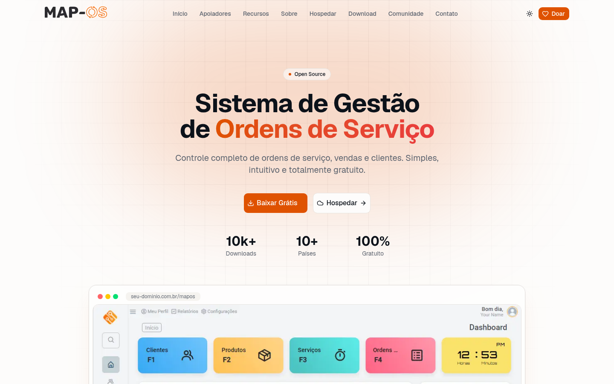
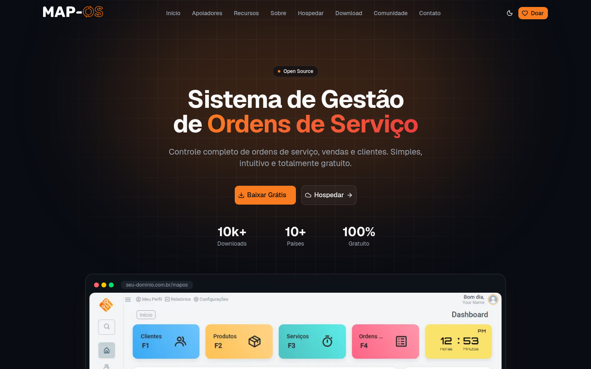
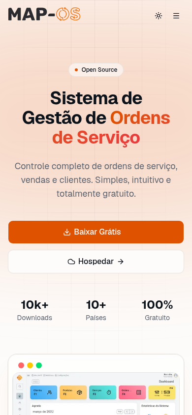

<div align="center">


# Site oficial do Map-OS

Site institucional do **[Map-OS](https://github.com/RamonSilva20/mapos)**, o sistema open source de gestão de ordens de serviço, vendas e clientes.

[](https://nextjs.org)
[](https://react.dev)
[](https://www.typescriptlang.org)
[](https://tailwindcss.com)
[](https://ui.shadcn.com)

[Site](https://mapos.com.br) · [Repositório do sistema](https://github.com/RamonSilva20/mapos) · [Documentação](https://github.com/RamonSilva20/mapos/wiki) · [Doar](https://donate.mapos.com.br)

</div>

---

## Sumário

- [Visão geral](#visão-geral)
- [Prévia](#prévia)
- [Funcionalidades](#funcionalidades)
- [Stack](#stack)
- [Começando](#começando)
- [Variáveis de ambiente](#variáveis-de-ambiente)
- [Scripts](#scripts)
- [Estrutura do projeto](#estrutura-do-projeto)
- [Editando o conteúdo](#editando-o-conteúdo)
- [Formulários](#formulários)
- [Tema e design](#tema-e-design)
- [SEO](#seo)
- [Deploy](#deploy)
- [Contribuindo](#contribuindo)
- [Mantenedores](#mantenedores)

## Visão geral

Este repositório é o redesign do site [mapos.com.br](https://mapos.com.br). O site antigo usava HTML, jQuery, Bootstrap e PHP. Esta versão foi reescrita em **Next.js (App Router)** e mantém todo o conteúdo original com um visual mais moderno.

É uma **landing page única** com navegação por âncoras, mais as páginas legais:

| Rota | Conteúdo |
| --- | --- |
| `/` | Início, Apoiadores, Recursos, Sobre, Hospedar, Download, Comunidade, Newsletter e Contato |
| `/politica-privacidade` | Política de Privacidade |
| `/termos-de-uso` | Termos de Uso |
| `/sitemap.xml` · `/robots.txt` | Gerados automaticamente |

## Prévia

| Claro | Escuro | Mobile |
| --- | --- | --- |
|  |  |  |

## Funcionalidades

- **Página única e responsiva**: menu fixo com desfoque, menu lateral no celular e rolagem suave até as seções
- **Tema claro/escuro**: segue o sistema operacional por padrão e tem um botão para alternar
- **Animações de entrada** com [Motion](https://motion.dev), que respeitam `prefers-reduced-motion`
- **Conteúdo centralizado** em arquivos TypeScript, sem precisar mexer nos componentes
- **Apoiadores com vencimento**: saem do site sozinhos depois da data definida
- **Formulários com server actions**: validação com Zod, envio de e-mail pelo Resend e proteção antispam (campo oculto + limite de envios por IP)
- **SEO**: metadados, Open Graph, Twitter Card, `sitemap.xml` e `robots.txt`
- **Imagens otimizadas** com `next/image` e fontes carregadas com `next/font`

## Stack

| Categoria | Tecnologia |
| --- | --- |
| Framework | [Next.js 16](https://nextjs.org) (App Router, Turbopack) + React 19 |
| Linguagem | TypeScript |
| Estilo | [Tailwind CSS v4](https://tailwindcss.com) + [`@tailwindcss/typography`](https://github.com/tailwindlabs/tailwindcss-typography) |
| Componentes | [shadcn/ui](https://ui.shadcn.com) (base Radix) |
| Ícones | [lucide-react](https://lucide.dev) + [simple-icons](https://simpleicons.org) (marcas) |
| Animações | [Motion](https://motion.dev) |
| Tema | [next-themes](https://github.com/pacocoursey/next-themes) |
| Notificações | [Sonner](https://sonner.emilkowal.ski) |
| Validação | [Zod 4](https://zod.dev) |
| E-mail | [Resend](https://resend.com) |

## Começando

### Pré-requisitos

- **Node.js 20.9+** (recomendado: 22 LTS)
- **npm** 10+

### Instalação

```bash
# 1. Clone o repositório
git clone <url-deste-repositorio> site-mapos
cd site-mapos

# 2. Instale as dependências
npm install

# 3. Configure as variáveis de ambiente
cp .env.example .env.local

# 4. Rode em modo de desenvolvimento
npm run dev
```

Acesse **http://localhost:3000**.

> Sem as variáveis de e-mail, o site funciona normalmente. Só os formulários mostram uma mensagem de erro amigável ao enviar.

## Variáveis de ambiente

Defina em `.env.local` (desenvolvimento) ou no painel do provedor de hospedagem (produção):

| Variável | Obrigatória | Descrição |
| --- | :---: | --- |
| `RESEND_API_KEY` | Sim\* | Chave da API do [Resend](https://resend.com/api-keys) |
| `CONTACT_TO_EMAIL` | Sim\* | Quem recebe as mensagens. Aceita vários, separados por vírgula |
| `CONTACT_FROM_EMAIL` | Não | Remetente, ex.: `Map-OS <site@mapos.com.br>`. O domínio precisa estar [verificado no Resend](https://resend.com/domains). Padrão: `onboarding@resend.dev` |

\* Necessárias apenas para os formulários enviarem e-mails.

## Scripts

| Comando | Descrição |
| --- | --- |
| `npm run dev` | Servidor de desenvolvimento com hot reload |
| `npm run build` | Build de produção |
| `npm start` | Serve o build de produção |
| `npm run lint` | Verifica o código com ESLint |

## Estrutura do projeto

```
.
├── docs/                         # Capturas de tela usadas neste README
├── public/img/                   # Logos, favicons, prints do sistema e logos de apoiadores
└── src/
    ├── app/
    │   ├── layout.tsx            # Layout raiz: metadados/SEO, fontes, tema, header, footer e toasts
    │   ├── page.tsx              # Landing page (junta as seções)
    │   ├── actions.ts            # Server actions dos formulários (apoiador e newsletter)
    │   ├── globals.css           # Tailwind, tokens de cor (claro/escuro) e utilitários
    │   ├── politica-privacidade/ # Página legal
    │   ├── termos-de-uso/        # Página legal
    │   ├── sitemap.ts            # /sitemap.xml
    │   └── robots.ts             # /robots.txt
    ├── components/
    │   ├── sections/             # Uma seção da landing por arquivo
    │   │   ├── hero.tsx
    │   │   ├── supporters.tsx
    │   │   ├── features.tsx
    │   │   ├── about.tsx         # + about-gallery.tsx (galeria interativa)
    │   │   ├── hosting.tsx
    │   │   ├── download.tsx
    │   │   ├── community.tsx
    │   │   ├── newsletter.tsx
    │   │   └── contact.tsx       # Formulário "Seja um Apoiador"
    │   ├── ui/                   # Componentes shadcn/ui
    │   ├── site-header.tsx       # Menu fixo + menu mobile
    │   ├── site-footer.tsx
    │   ├── reveal.tsx            # Animação de entrada ao rolar
    │   ├── section-heading.tsx   # Título padrão das seções
    │   ├── brand-icon.tsx        # Ícones de redes sociais (simple-icons)
    │   ├── legal-page.tsx        # Layout das páginas legais
    │   ├── logo.tsx
    │   ├── theme-provider.tsx
    │   └── theme-toggle.tsx
    ├── content/
    │   ├── site.ts               # Todo o conteúdo editável do site
    │   └── supporters.ts         # Lista de apoiadores
    └── lib/utils.ts
```

## Editando o conteúdo

A maior parte das mudanças do dia a dia é feita em **`src/content/`**, sem tocar nos componentes.

### Textos, links e números: `src/content/site.ts`

| Export | O que controla |
| --- | --- |
| `links` | GitHub, releases, wiki, doação, hospedagem SysGo, WhatsApp |
| `social` | Redes sociais (rodapé e seção Comunidade) |
| `nav` | Itens do menu |
| `heroStats`, `aboutStats`, `communityStats` | Números exibidos nas seções |
| `features` | Cartões da seção Recursos (título, descrição, ícone lucide) |
| `aboutHighlights` | Abas da galeria "Conheça o Sistema" (texto + imagem) |
| `hostingPerks` | Vantagens da hospedagem SysGo |
| `release` | **Versão atual do Map-OS** e textos da seção Download |
| `maintainers`, `contact` | Mantenedores, localização e telefone |

#### Publicando uma nova versão

Atualize só o campo `version`:

```ts
export const release = {
  version: "v4.54.0",
  // ...
}
```

### Apoiadores: `src/content/supporters.ts`

1. Coloque o logo em `public/img/apoiador/` (de preferência PNG com fundo transparente)
2. Adicione um item à lista:

```ts
{
  name: "Nome da Empresa",
  logo: "/img/apoiador/empresa.png",
  description: "Uma frase sobre o apoio ao projeto.",
  link: "https://empresa.com.br",
  vencimento: "2027-06-30", // opcional (AAAA-MM-DD)
},
```

Depois da data de `vencimento`, o apoiador some do site sozinho. A página inicial é regerada **uma vez por dia** (`revalidate = 86400` em `src/app/page.tsx`), então a remoção acontece em até 24h, sem novo deploy.

### Páginas legais

Edite direto o JSX em `src/app/politica-privacidade/page.tsx` e `src/app/termos-de-uso/page.tsx`. A formatação do texto vem do plugin `typography`.

## Formulários

Os dois formulários são **server actions** (`src/app/actions.ts`) usados com `useActionState`, sem API REST separada.

| Formulário | Seção | Campos |
| --- | --- | --- |
| **Seja um Apoiador** | `#contato` | Empresa\*, Site, Nome\*, WhatsApp/Telefone, E-mail\*, Mensagem |
| **Newsletter** | Antes do contato | E-mail\* |

Como funcionam:

1. **Validação** no servidor com Zod. Os erros aparecem abaixo de cada campo.
2. **Antispam**: um campo oculto (`nickname`) que só robôs preenchem, mais um limite de **5 envios por IP a cada 10 minutos**.
3. **Envio** pelo Resend para `CONTACT_TO_EMAIL`, com `reply-to` apontando para o e-mail de quem preencheu. Assim dá para responder direto do cliente de e-mail.
4. **Retorno**: uma notificação (toast) de sucesso ou erro. Quando há erro, o que a pessoa digitou continua preenchido.

> **Observações**
> - O limite por IP fica na memória do processo. Em ambientes serverless com várias instâncias ele é aproximado. Para um controle rígido, use um armazenamento compartilhado (ex.: Upstash Redis).
> - A newsletter hoje só **envia um e-mail avisando** de cada nova inscrição. Para montar uma lista de contatos, integre com um serviço como Resend Audiences, Mailchimp ou Brevo em `subscribeNewsletter`.

## Tema e design

- **Cores**: definidas como variáveis CSS (OKLCH) em `src/app/globals.css`, nos blocos `:root` (claro) e `.dark` (escuro). A cor principal (`--primary`) é o laranja do logo do Map-OS.
- **Utilitários próprios**: `bg-grid` (grade de fundo do hero) e `text-gradient` (texto em degradê).
- **Tipografia**: Geist, carregada com `next/font`.
- **Novos componentes shadcn/ui**:

  ```bash
  npx shadcn@latest add <componente>
  ```

## SEO

- Metadados globais, Open Graph e Twitter Card em `src/app/layout.tsx` (`metadataBase: https://mapos.com.br`)
- Título por página com o template `%s | Map-OS`
- `sitemap.xml` e `robots.txt` gerados em `src/app/sitemap.ts` e `src/app/robots.ts`
- HTML semântico em pt-BR, textos alternativos nas imagens e rótulos de acessibilidade na navegação

Se o domínio mudar, atualize a URL em `layout.tsx`, `sitemap.ts` e `robots.ts`.

## Deploy

### Vercel (recomendado)

1. Importe o repositório em [vercel.com/new](https://vercel.com/new)
2. Cadastre as [variáveis de ambiente](#variáveis-de-ambiente)
3. Faça o deploy. A Vercel detecta o Next.js sozinha.
4. Aponte o domínio `mapos.com.br` para o projeto em *Settings → Domains*

### Servidor Node próprio

```bash
npm ci
npm run build
PORT=3000 npm start
```

Use um gerenciador de processos (PM2, systemd) e um proxy reverso (Nginx, Caddy) com HTTPS. Repasse o cabeçalho `X-Forwarded-For` para o limite por IP funcionar.

> Este projeto **precisa de um servidor Node** por causa dos formulários e da regeração diária da página. Não funciona como export estático (`output: "export"`).

## Contribuindo

1. Crie um branch: `git checkout -b feat/minha-melhoria`
2. Faça as alterações e rode `npm run lint` e `npm run build`
3. Confira no navegador os temas claro e escuro e a versão mobile
4. Abra um Pull Request descrevendo a mudança (com prints, se for visual)

Contribuições para o **sistema** Map-OS (não para o site) vão no repositório [RamonSilva20/mapos](https://github.com/RamonSilva20/mapos).

## Mantenedores

| Nome | Contato |
| --- | --- |
| Gianluca Bine | [gian@mapos.com.br](mailto:gian@mapos.com.br) |
| Wilmerson | [wilmerson@mapos.com.br](mailto:wilmerson@mapos.com.br) |

**Comunidade:** [GitHub](https://github.com/RamonSilva20/mapos) · [WhatsApp](https://chat.whatsapp.com/GVSg8tPQzXy0grfYpRfQps?mode=hqrt3) · [Instagram](https://www.instagram.com/maposoficial/) · [Facebook](https://facebook.com/mapOsOficial) · [Twitter/X](https://twitter.com/MapOsOficial)

Hospedagem oficial: **[SysGo](https://cliente.sysgo.com.br/index.php?rp=%2Fstore%2Fsistemas&utm_source=site_mapos)**

---

<div align="center">
Feito com ❤️ pela comunidade Map-OS · <a href="https://donate.mapos.com.br">Apoie o projeto</a>
</div>
